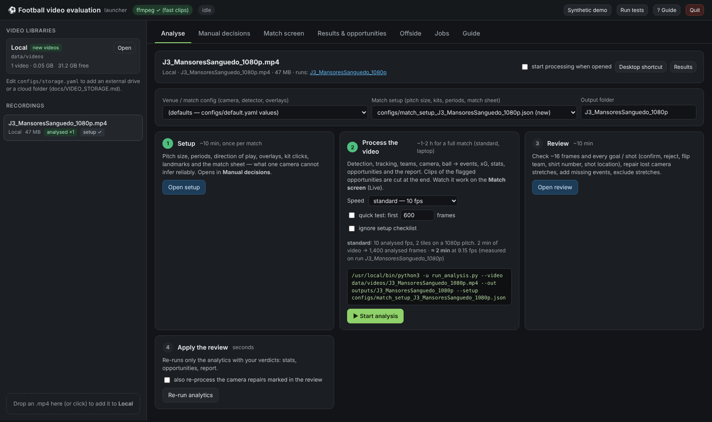
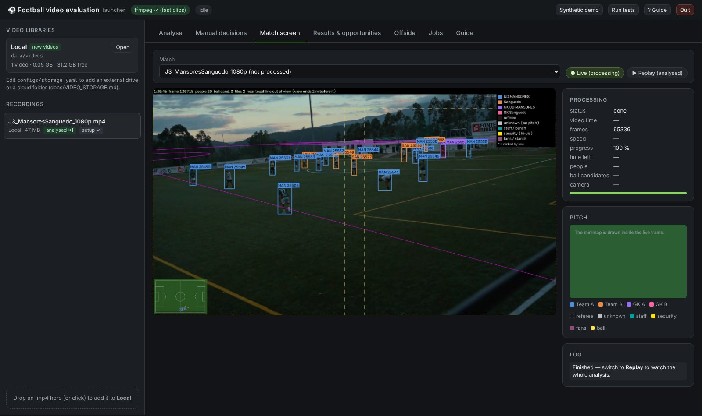
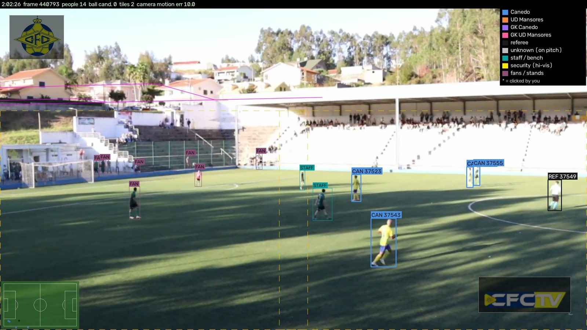
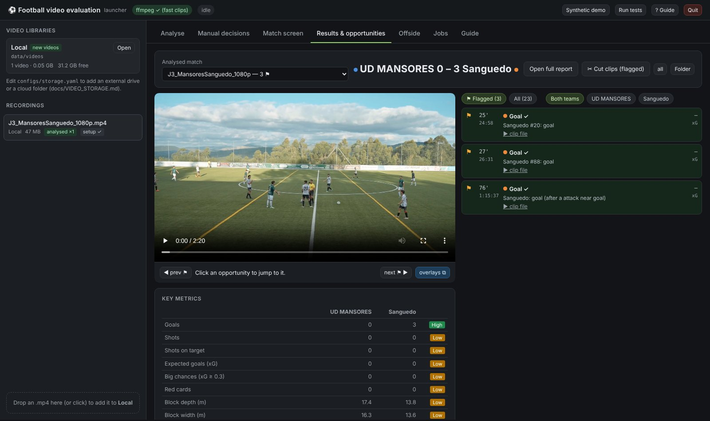
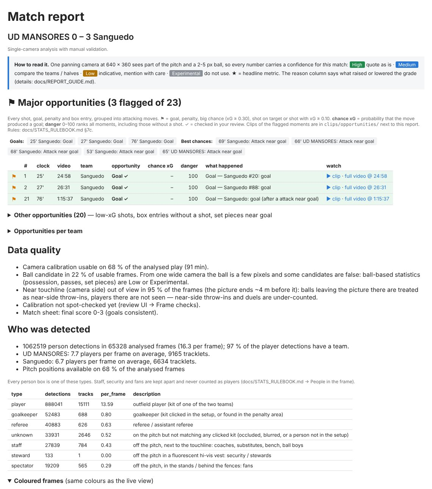
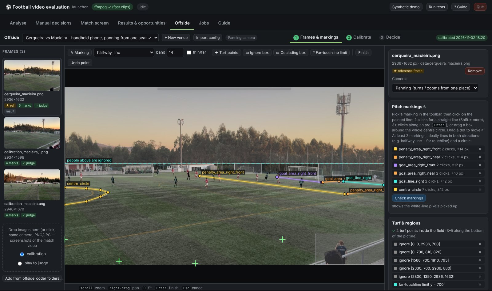
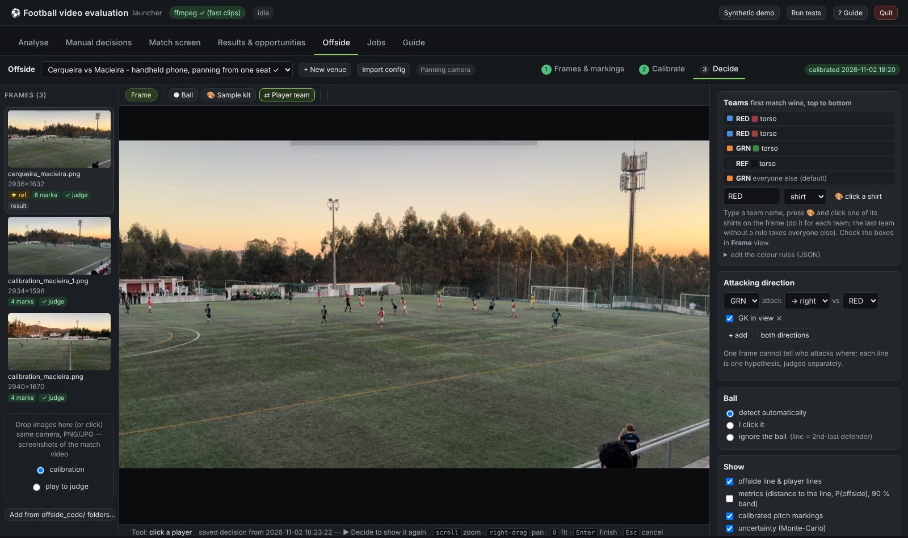
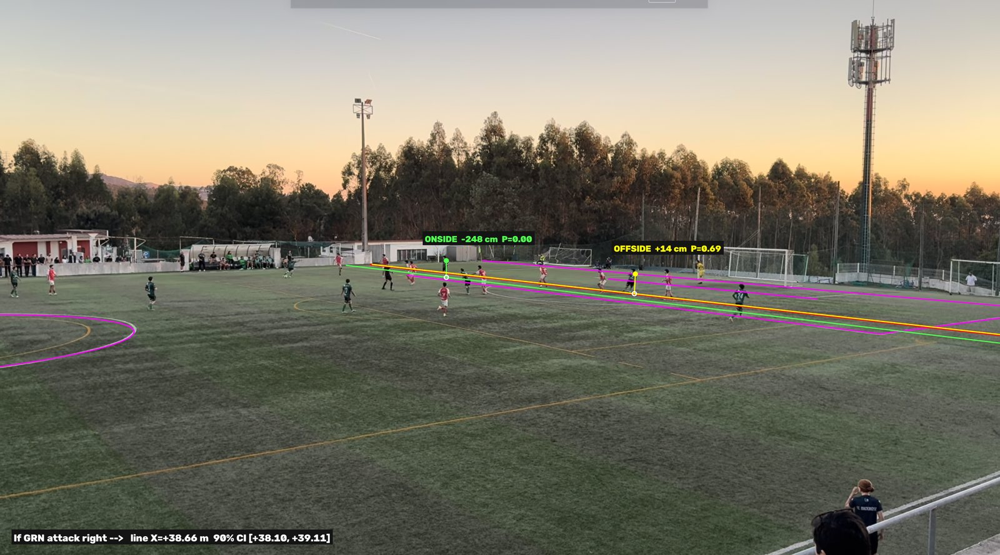
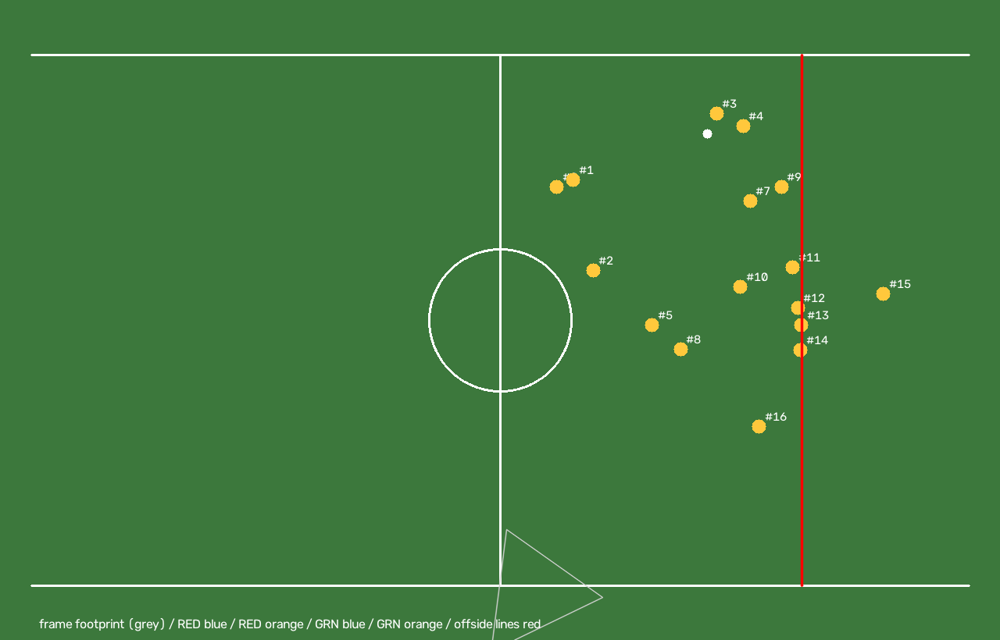

# Football video evaluation

Football analytics from one camera, in two independent projects that share one dashboard and one Python
environment:

| Folder | What it does | Docs |
|---|---|---|
| [`global_video_analysis/`](global_video_analysis/) | Full-match analysis of an mp4: detection, tracking, teams, camera, ball → events, xG, team / player stats, timeline, flagged opportunities, report | [`README`](global_video_analysis/README.md), [`USER_GUIDE`](global_video_analysis/docs/USER_GUIDE.md) |
| [`offside_code/`](offside_code/) | Offside / onside on a single frame: semi-manual camera calibration from a set of images, then the decision with geometrically correct offside lines and uncertainty | [`README`](offside_code/README.md), [`STUDIO_GUIDE`](offside_code/docs/STUDIO_GUIDE.md) |

## Screenshots

Real recordings of UD Mansores matches, one camera each, processed on a laptop.

**Dashboard: pick a recording, run the four steps** (setup, process, review, re-run analytics)



**Player detection and team classification, live while processing.** Boxes in the shirt colour of each team
(clicked once in the setup), goalkeepers and referee apart; coaches, security and fans are tagged `STAFF` / `SEC` /
`FAN` and never counted as players. Pitch lines come from the tracked camera pose, the minimap from the
homography; the dashed rectangles are the detector tiles laid over the pitch only.

| Match screen, live (J3, evening light) | Live frame (Canedo vs UD Mansores) |
|---|---|
|  |  |

**Results and flagged opportunities:** score, every goal / shot / attack near goal with its clip, key metrics graded
by confidence for this match, and the full HTML report (data quality, who was detected).

| Results & opportunities tab | Match report |
|---|---|
|  |  |

**Offside on a single frame** (`offside_code/`, *Offside* tab): click the painted lines on a few frames of one
camera to calibrate it, then decide. Each attacker gets OFFSIDE / ONSIDE with the distance to the line and a
probability from the calibration uncertainty; the bird's-eye view shows the reconstruction.

| Calibration: click the pitch markings | Decide: teams, direction, ball |
|---|---|
|  |  |

| Decision (Cerqueira vs Macieira, handheld phone) | Bird's-eye reconstruction |
|---|---|
|  |  |

## Start

Double-click **`start.command`** (macOS; `./start.command` on Linux, **`start.bat`** on Windows) — or the
*Football Video Analysis* shortcut on the Desktop. Both run `setup_env.py` (see *Python and packages* below), which
builds `.venv/` the first time; then the dashboard opens at http://127.0.0.1:8770:

* tabs **Analyse · Manual decisions · Match screen · Results & opportunities** — `global_video_analysis`;
* tab **Offside** — `offside_code` (venues, click-to-mark calibration, decision on a chosen frame);
* tabs **Jobs · Guide** — background jobs and every guide (including the Offside tab guide).

```bash
./start.command                                   # dashboard
./start.command --open offside                    # straight to the Offside tab
./start.command --video <file.mp4> --start        # process a recording at once
```

From a terminal with the venv active, each project also runs on its own:
`python global_video_analysis/scripts/launcher.py`, `python offside_code/offside_studio.py`, and all the CLIs
described in the two READMEs (run them from inside their folder).

## Python and packages (the same on every computer)

| | |
|---|---|
| **Python** | **3.12, 3.13 or 3.14**, 64-bit; 3.13 recommended (`.python-version`). **3.15 is not supported yet**: onnxruntime has no wheels for it, which is the `No matching distribution found for onnxruntime` error. 3.11 and older are too old for numpy 2.5 / scipy 1.18 |
| **Versions** | exact pins in [`constraints.txt`](constraints.txt) (numpy, scipy, pandas, OpenCV, scikit-learn, matplotlib, PyYAML, onnxruntime), tested together; [`requirements.txt`](requirements.txt) lists what both projects need |
| **Setup** | [`setup_env.py`](setup_env.py), run by `start.command` / `start.bat`: finds a supported Python (offers to install 3.13 with the Python install manager, winget or Homebrew if there is none), rebuilds `.venv` when it was made with another Python, installs the pins, picks `onnxruntime-gpu` on an NVIDIA computer, and checks the result |
| **Check** | `python setup_env.py --check`, or at every dashboard start: any difference from the pins is printed |
| **Optional** | PyTorch-based upgrades (ultralytics, SigLIP, ByteTrack, OCR): [`requirements-optional.txt`](requirements-optional.txt) |

```bash
python3 setup_env.py              # build / repair .venv (fast when nothing changed)   Windows: py setup_env.py
python3 setup_env.py --check      # compare the installed versions with constraints.txt
python3 setup_env.py --force      # reinstall everything
```

Any Python 3.8+ can run `setup_env.py` (the Mac's own `python3`, a new 3.15 ...): it only bootstraps and builds the
environment with a supported version. Each computer has its own `.venv`; if the folder is synced between a Mac and a
PC, the second one gets `.venv-windows` / `.venv-posix` instead of overwriting the first. To upgrade a package:
change its pin in `constraints.txt`, run `setup_env.py` and both test suites, commit.

## Windows

Supported the same way as macOS / Linux. Double-click **`start.bat`**: `setup_env.py` uses Python 3.13 (or 3.12 /
3.14; if the PC only has 3.15 or none, it offers to install 3.13 with `pymanager` or `winget`), creates `.venv\`,
installs the pinned packages, switches to the GPU build on an NVIDIA computer and opens the dashboard. Optional: [ffmpeg](https://www.gyan.dev/ffmpeg/builds/) on the PATH cuts the
opportunity clips faster (without it OpenCV re-encodes them). Notes:

* everything is read and written as UTF-8 (`start.bat` also sets `PYTHONUTF8=1`), so setups, reports and logs made
  on the Mac open unchanged on Windows and back; relative paths in the setups always use `/`;
* the PC is kept awake while a match is processed (like `caffeinate` on the Mac);
* *Desktop shortcut* writes a `.bat` (also into a OneDrive Desktop) that goes through `start.bat`;
* `cut_highlights.sh` / `cut_opportunities.sh` in the outputs are bash scripts; on Windows use
  `python scripts/cut_opportunities.py --run outputs/<match>` or the *Cut clips* button instead;
* video libraries in `configs/storage.yaml` that point to Mac folders are skipped; add the Windows folders there
  (recordings are also found by file name, so a setup made on the Mac finds its video on the PC).

From a terminal: `.venv\Scripts\activate`, then the same commands as below with `python`.

## GPU (automatic)

The analysis runs on any laptop's CPU and uses a GPU by itself when the computer has one: the person / ball detector
(~95 % of the processing time) benchmarks every accelerator it can reach and keeps the fastest.

| Computer | What is used | Setup |
|---|---|---|
| NVIDIA GPU (Windows / Linux) | onnxruntime CUDA (TensorRT with `--device tensorrt`); PyTorch models on `cuda:0` | none: `setup_env.py` installs `onnxruntime-gpu[cuda,cudnn]` (same version as the CPU pin) when `nvidia-smi` works (needs a recent NVIDIA driver) |
| Other GPU on Windows | DirectML | `pip uninstall onnxruntime && pip install onnxruntime-directml` |
| Mac (Apple Silicon) | CoreML when faster than the CPU; PyTorch models on `mps` | none |
| No GPU | CPU (all cores) | none |

Check a computer: `cd global_video_analysis && python -m football_eval.accel`. Force the CPU: `run_analysis.py
--device cpu`, or `detection.runtime: cpu` in the config. `offside_code` uses OpenCV's CUDA backend when OpenCV was
built with it (`OFFSIDE_DEVICE=cpu` to disable); it works on one frame, so the CPU is enough there.

## Layout

```
football_video_evaluation/
├── start.command            dashboard launcher, macOS / Linux  (runs setup_env.py --run)
├── start.bat                same on Windows
├── setup_env.py             supported Python + .venv + pinned packages + GPU runtime, the same on every computer
├── constraints.txt          exact package versions;  requirements.txt  what both projects need
├── .venv/                   Python environment of both projects (git-ignored)
├── global_video_analysis/   match analysis  (football_eval/, scripts/, configs/, docs/, notebooks/, tests/, outputs/, data/)
└── offside_code/            single-frame offside (offside/, configs/, calibration/, venues/, docs/, notebooks/, tests/)
```

The two projects do not import each other, except that the dashboard (`global_video_analysis/football_eval/ui/
launcher.py`) mounts `offside_code/offside/studio.py` under `/off/`, and `global_video_analysis` can re-use the
YOLOX model and a stationary camera model of `offside_code` (`scripts/get_models.py`, `configs/example_anadia.yaml`).
