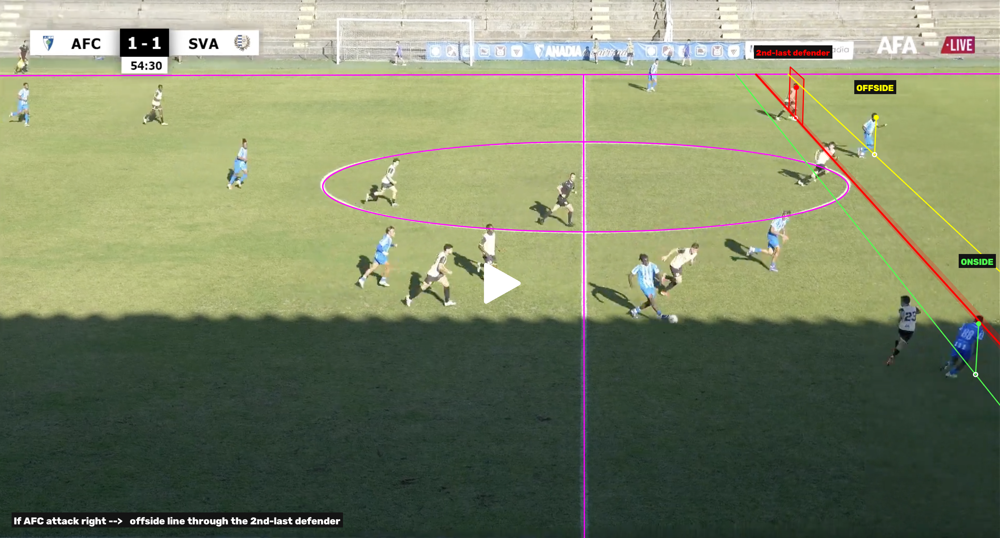
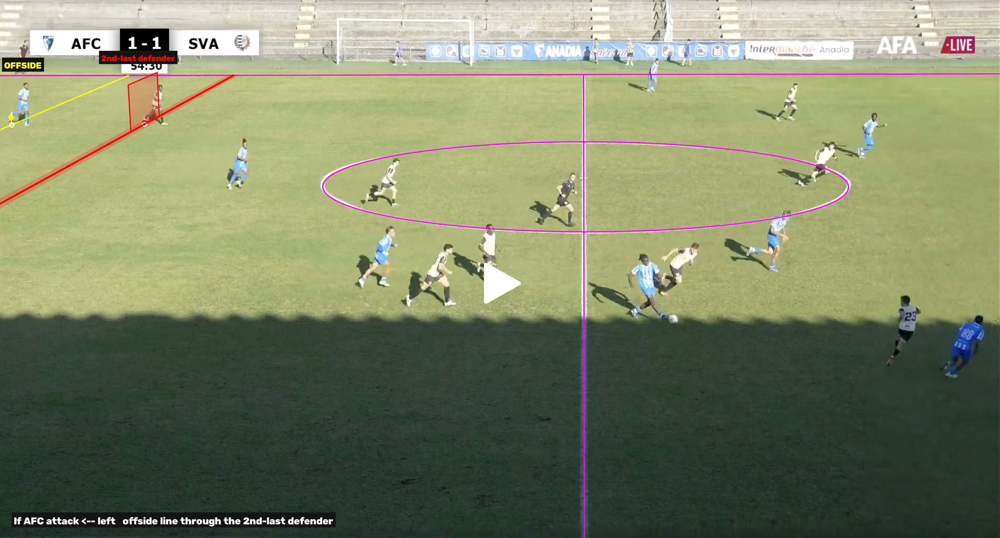
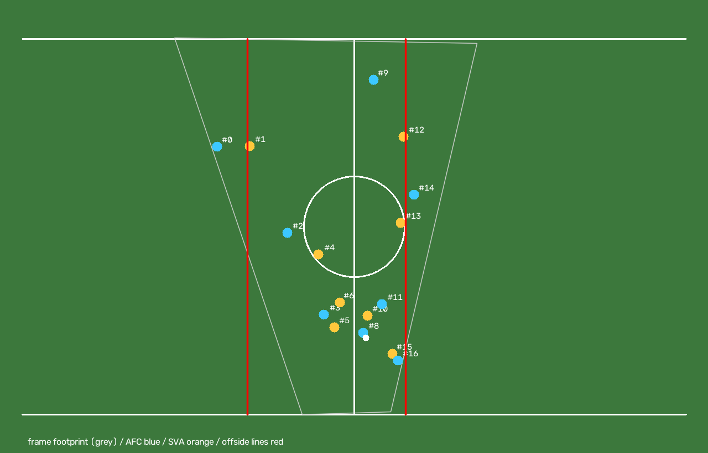

# Offside lines from a stationary match camera

Draws geometrically correct offside lines on a frame of a football match and decides **OFFSIDE / ONSIDE**
for every attacker. Built for the typical lower-league set-up: **one camera that never moves**.

* **Once per camera (venue):** calibrate it from the decision frame plus any number of frames from
  *other plays* of the match → a saved camera model (`calibration/*.json`).
* **Per play (~1.5 s on a laptop CPU):** give an image → players, body keypoints, teams and the ball are
  detected → body parts are placed on the pitch → decision + annotated images.

**In the dashboard:** this folder is the **Offside** tab of `football_video_evaluation` (`../start.command` →
tab *Offside*, or `python offside_studio.py` on its own): drop a set of images, click the pitch markings
(semi-manual calibration), calibrate, choose a frame → OFFSIDE / ONSIDE with or without the lines and the
metrics. Step by step: [`docs/STUDIO_GUIDE.md`](docs/STUDIO_GUIDE.md). Venues made there live in `venues/<name>/`
(`venue.json` is a config of the format below, so every CLI here works on it).

| If AFC attack → right | If AFC attack ← left | Bird's-eye reconstruction |
|---|---|---|
|  |  |  |

Red = offside line through the second-last defender (shaded band = 90 % confidence), yellow = attacker
in an offside position, green = onside, magenta = calibrated pitch template re-projected on the image
(it should sit on the painted lines). The vertical red "curtain" marks the plane through the defender.

---

## Quick start

```bash
cd offside_code                                # inside football_video_evaluation/ (the shared ../.venv works too)
python -m venv .venv && source .venv/bin/activate
pip install -r requirements.txt
python offside_studio.py                       # the web workflow (same as the dashboard's Offside tab)
python scripts/download_models.py              # only if models/ is empty (≈ 41 MB, OpenCV Model Zoo)

# 1) once: put frames of other plays (same camera, same resolution) in data/calibration_frames/
python calibrate_camera.py                     # -> calibration/anadia_camera.json (+ median background)

# 2) every play
python run_offside.py --image path/to/play.png             # decision-only images in outputs/
python run_offside.py --image play.png --ball 1972 947     # override the automatic ball position
python run_offside.py --metrics                            # also write distances / P(offside)
python run_offside.py --no-lines --no-pitch                # decisions only (labels, no lines)
python calibrate_camera.py --config configs/macieira.json  # panning camera: every aux frame has its own camera

python scripts/benchmark.py                    # timing of each stage
python tests/test_fixed_camera_synthetic.py    # why frames of other plays help (known ground truth)
jupyter notebook notebooks/offside_demo.ipynb  # step-by-step demo
```

Outputs go to `outputs/`: one image per scenario, `birds_eye.png`, and `offside_result.json`
(decisions, margins, probabilities, 90 % intervals, timings).

## Folder structure

| Path | What it is |
|---|---|
| `offside/camera.py` | Pinhole camera model: projection, back-projection onto the pitch, vanishing points, homography |
| `offside/template.py` | FIFA pitch template (Law 1): every line, circle, arc and spot as a named element, parameterised by pitch length/width |
| `offside/features.py` | White-line mask (shadow-robust), hint-based extraction, automatic line/ellipse candidates, stripe re-centring |
| `offside/calibration.py` | Least-squares calibration against the template: markings, players as rulers, constraints, priors; multi-frame support |
| `offside/venue.py` | **Stationary camera**: frame alignment check, median background, pooled players, camera draws, camera-model file |
| `offside/predict.py` | **Fast per-play judgement** with a saved camera model (`OffsidePredictor`) |
| `offside/players.py` | YOLOX person + ball detection (tiled), MediaPipe BlazePose keypoints, upright test, team colour rules |
| `offside/decision.py` | 3-D lifting of keypoints, Law-11 logic, offside line, uncertainty summary |
| `offside/render.py` | Annotated frames (decision-only by default) and bird's-eye view |
| `offside/pipeline.py` | One-shot run that calibrates and judges the same frame (also supports a panning camera) |
| `offside/studio.py`, `offside/ui/studio.html` | **Offside tab** of the dashboard (also `offside_studio.py`): venues, image upload, click-to-mark pitch markings, calibration job, decision with toggles for lines / metrics / pitch |
| `offside_studio.py` | CLI — the studio on its own page (http://127.0.0.1:8775) |
| `venues/<name>/` | venues made in the tab: `venue.json` (config + clicked markings), `images/`, `camera_model.json`, `results/` |
| `docs/STUDIO_GUIDE.md` | how to use the Offside tab |
| `offside/synthetic.py` | Renders synthetic frames from a known camera (tests / demo) |
| `calibrate_camera.py` | CLI — build the camera model from many frames (stationary camera) or from frames with their own markings (panning camera, one camera per frame) |
| `run_offside.py` | CLI — judge one image (`--metrics`, `--no-lines`, `--no-pitch`, `--no-ball`) |
| `configs/anadia_example.json` | Config for the Anadia FC – SVA camera |
| `calibration/anadia_camera.json` | Saved camera model (today built from the single available frame) |
| `data/frame_decision.png` | The decision frame;  `data/calibration_frames/` — put frames of other plays here |
| `notebooks/offside_demo.ipynb` | Interactive walkthrough (built by `scripts/build_notebook.py`) |
| `scripts/benchmark.py` | Per-stage timing;  `scripts/download_models.py` — fetch the ONNX models |
| `tests/test_fixed_camera_synthetic.py` | Stationary camera: accuracy vs number of extra frames (ground truth known) |
| `tests/test_multiframe_synthetic.py` | Panning camera variant (frames showing other markings) |
| `tests/test_studio_synthetic.py` | Offside tab back end + per-frame panning-camera model (synthetic, ~1 min) |
| `models/` | `yolox.onnx` (person + ball detector), `mp_pose.onnx` (pose) |

---

## How it works

### 1. Why "parallel" offside lines are not parallel on screen
The pitch is a plane, so a camera maps it to the image with a homography **H** (3×3). An offside line is
the pitch line `X = const` (parallel to the goal line). All of them meet at the image of the point at
infinity in the goal-line direction, the vanishing point `v = H·(0, 1, 0)ᵀ`. The halfway line is one of
these lines, so `v` lies on it — but *where* on it decides how much the lines fan out, and that is the
hard part to get from one frame.

A head or a shoulder is **not** on the pitch, so a line drawn through it in the image is wrong. Each body
part has to be placed in 3-D and dropped vertically; that needs the full camera
`P = K·R·[I | −C]`, not just H.

### 2. Pitch markings (`features.py`)
* Line response = local contrast `(L − open(L)) / open(L)` on the Lab lightness — works in sun and in the
  stand's shadow; gated by low saturation and a grass mask.
* **Hints**: per element, 2 clicks (lines), 3–5 clicks (arcs) or a bounding box (centre circle). Pixels in a
  band around the hint are cleaned with RANSAC and then the **whole painted stripe** is re-selected from a
  1-px histogram of signed distances, so the kept pixels are centred on the line (an edge-only fit biases
  thick near-camera lines by several pixels).
* **Candidates**: speckle-filtered mask → sequential RANSAC lines + pooled RANSAC ellipses, drawn with ids
  you map to element names. Deep-shadow grass texture can create junk candidates (just don't map them) and
  thin far-away lines are often missed — add those with a hint (`"loose": true` for the far touchline).
* Any learned field-keypoint detector (PnLCalib / NBJW weights) can replace this: it only has to return
  `{element_name: pixels}`.

### 3. Calibration (`calibration.py`, `venue.py`)
Unknowns: focal length `f`, rotation `R`, camera centre `C`, pitch half-length/half-width, a principal-point
offset and a free "shoulder height" scale for the player cue. Robust (soft-L1) least squares, the same idea
as PnLCalib's point-and-line refinement, with every residual expressed in standard deviations:

| Term | Residual | Weight |
|---|---|---|
| line element | back-project the pixel onto the pitch, snap the fixed coordinate (e.g. `X = 0`), re-project, image distance | each element ≤ 30 effective observations, σ = 3 px |
| circle / arc | back-project, snap onto the circle along the same angle, re-project | same |
| point (spot, corner) | re-projection error | σ = 3 px |
| `inside_pitch` | hinge: pixels marked as turf inside the field must back-project inside the template — "the near touchline is **not** visible" | near-hard |
| players: height | observed foot→shoulder length / projected length of a common (free) height | 1 obs. per player, σ 10 % (6 % upright) |
| players: verticality | upright players' body axis vs the projected vertical at their feet | 1 obs. per upright player, σ 4° |
| priors | 105 × 68 m template (σ 2.5 / 2 m), principal point near the centre (σ 40 px) | 1 obs. each |

Why "≤ 30 effective observations" per painted element: the thousands of pixels of a line are not
independent — painting errors, line width and lens effects are shared by all of them. Counting them as
independent lets a slightly oval centre circle overrule every other cue.

**Stationary camera — calibrating from other plays.** Every frame of the match shares exactly the same
camera, so `venue.calibrate_fixed_camera`:
1. checks each frame is aligned with the reference (phase correlation; shifted frames are left out),
2. builds the **per-pixel median background** → players disappear, the markings are complete,
3. extracts the markings once on the background (same hints as the decision frame),
4. detects players in **every** frame and pools them as calibration objects — a body is a ruler of
   unknown but common length standing on the pitch; ratios between near and far players fix the
   perspective, and upright bodies (stoppages, walking) point at the vertical vanishing point,
5. solves once, then stores 150 Monte-Carlo camera draws in the camera model.

Why it matters — `tests/test_fixed_camera_synthetic.py`, same view as the real frame (halfway line, far
touchline, centre circle painted 1.3 % out of round), ~15 players per extra frame, 30 % of them upright:

| Frames of other plays | Players pooled | Max error of a player's position along the pitch |
|---|---|---|
| 0 (one frame only) | 0 | ≈ 10.3 m |
| 1 | 15 | ≈ 6.6 m |
| 10 | 150 | ≈ 1.8 m |
| 40 | 600 | ≈ 0.9 m |

With only these markings the perspective is almost undetermined (a 30 % focal-length error costs almost
nothing), so a single frame is driven by priors and the `inside_pitch` constraint. More frames → more
players at more depths → the error keeps shrinking; **aim for 40+ frames**, ideally including stoppages
(free kicks, throw-ins, substitutions) where players stand upright, and players spread over the whole
visible pitch, including the far side and both edges of the image.

**Panning camera (phone from a seat, PTZ).** `camera.mode: "panning"` (default when the config has `aux_frames`):
the decision frame and every `aux_frames` entry have their own markings and are calibrated jointly with a shared
camera centre (`venue.calibrate_panning_camera`; players of every frame are added as rulers). The camera model
then stores one camera + Monte-Carlo draws **per frame** (`frame_cameras`), so `run_offside.py --image <frame>`
and the dashboard can judge any of those frames — `tests/test_multiframe_synthetic.py`: ≈ 10 m → ≈ 0.7 m with
one penalty-area frame. (`off.run()` still does calibrate-and-judge in one go.)

### 4. Players (`players.py`)
YOLOX (COCO person class, and the *sports ball* class for the ball's contact point) on overlapping
1150-px tiles starting just above the far touchline, NMS, then MediaPipe BlazePose on a square crop of
each player (33 keypoints). A player counts as *upright* when both knees are straight and hips/shoulders
are over the ankles. Partial duplicates are removed (shared shoulders / box containment). Teams come
from ordered colour rules on the torso and shorts polygons (first team whose rules pass), with manual
`team_overrides` by id. Players whose feet fall in an `occluding_regions` box are flagged and not used as
a calibration cue.

### 5. Lifting body parts and the decision (`decision.py`)
For every keypoint that counts under Law 11 (head, shoulders, hips, legs, feet — **not** arms/hands),
the viewing ray is intersected with the vertical plane through the player's support foot that faces the
camera, giving a 3-D point; its `X` is the position along the pitch. Then:

* second-last opponent = the deepest visible defending player (the goalkeeper is assumed off-frame
  and behind; set `"gk_visible": true` in a scenario if the keeper is in the picture),
* offside line `X* = max(second-last defender, ball, halfway line)` in the attacking direction,
* attacker is **OFFSIDE** if his forward-most allowed body part is beyond `X*`.

The direction of play and which team attacks cannot be read from one frame, so each `scenario` in the
config is rendered separately.

### 6. Uncertainty (Monte-Carlo)
At calibration time the camera is re-solved 150 times with bootstrap-resampled marking pixels and players,
pitch length/width drawn from N(105, 6) / N(68, 5) m, principal point ± 40 px, centre-circle painting
errors (2nd/3rd-harmonic radius errors ~1 %); the 150 cameras are stored in the camera model. Per play,
the decision is re-evaluated under each stored camera with keypoint noise (2 px) and body-depth noise
(35 cm) — this takes ~0.15 s. The images show the decision only; `offside_result.json` keeps
`p_offside`, margins and 90 % intervals (`--metrics` writes them on the images).

### 7. Speed — from image to decision
Measured with `scripts/benchmark.py` on the 2930 × 1578 frame (17 people), 2 CPU cores, no GPU:

| Stage | Time |
|---|---|
| person + ball detection (YOLOX, 6 tiles) | 1.05 s |
| pose (BlazePose, 17 crops) | 0.22 s |
| teams + geometry + decision | 0.01 s |
| uncertainty (150 stored cameras) | 0.16 s |
| **decision ready** | **≈ 1.4 s** |
| annotated images | 0.1 – 0.25 s |
| loading the models (once) | 0.1 s |
| calibrating the camera (once per venue, 150 draws) | ~1–2 min (+ ~1.3 s per extra frame for detection) |

Detection is ~75 % of the time. On an Apple-silicon MacBook expect roughly the same or faster; with a GPU
build of the same models (ONNX Runtime CUDA/CoreML, TensorRT) the per-play time drops to ~0.1–0.2 s, i.e.
fast enough for every frame of a replay. Faster options: fewer/larger tiles (`detector.tile`), skip
`--metrics`/images, or skip the uncertainty (`--no-uncertainty`).

---

## Config reference (`configs/*.json`)

```jsonc
{
  "decision_frame": {                                // the view of the (stationary) camera
    "image": "data/frame_decision.png",              // reference frame (also the default image to judge)
    "features": [                                    // hints (or "candidates_mapping": {...})
      {"element": "halfway_line",  "polyline": [[x,y],[x,y]], "band": 30},
      {"element": "touchline_far", "polyline": [[x,y],[x,y]], "band": 12, "loose": true},
      {"element": "centre_circle", "bbox": [x0,y0,x1,y1]}
    ],
    "inside_pitch": [[x,y], ...],                    // turf pixels inside the field of play
    "ignore_regions": [[x0,y0,x1,y1], ...],          // overlays: score bug, logos
    "occluding_regions": [[x0,y0,x1,y1]],            // overlays that can hide players' feet
    "ball_pixel": [x, y],                            // only used by the one-shot pipeline; run_offside detects the ball
    "player_min_y": 225                              // ignore people above the far touchline
  },
  "camera": {
    "mode": "fixed",                                 // or "panning" (each aux_frames entry has its own markings)
    "calibration_frames": ["data/calibration_frames/*.png"],   // frames of OTHER plays, same camera
    "camera_model": "calibration/anadia_camera.json",
    "n_draws": 150                                   // Monte-Carlo cameras stored in the model
  },
  "detector": {"tile": 1150, "stride": 900},         // smaller tiles = slower, slightly better on tiny players
  "teams": [ {"team": "AFC", "rules": [{"region": "shorts", "hsv_lo": [...], "hsv_hi": [...], "min": 0.2}]}, ... ],
  "team_overrides": {"12": "SVA"},
  "scenarios": [ {"attacking": "AFC", "defending": "SVA", "direction": "right"} ],
  "priors": {"half_length": [52.5, 2.5], "half_width": [34.0, 2.0], "shoulder_h": [1.40, 0.25]},
  "show_metrics": false
}
```
Element names: `halfway_line`, `touchline_far|near`, `goal_line_left|right`,
`penalty_area_{left|right}_{front|far|near}`, `goal_area_{left|right}_{front|far|near}`, `centre_circle`,
`penalty_arc_left|right`, `centre_spot`, `penalty_spot_left|right`, `corner_{far|near}_{left|right}`,
`halfway_far|near`. "Left/right" are the goals on the left/right of the main camera, "far/near" the
touchline away from / close to it.

---

## Results on the Anadia frame

Today the camera model is built from the single available frame (no frames of other plays yet):

* Camera: f ≈ 5 000 px (≈ 33° horizontal field of view), ≈ 59 m from the halfway line and ≈ 10 m high;
  re-projection ≈ 2–4 px on the lines, ≈ 5.4 px on the hand-painted centre circle.
* 17 people found: 8 AFC, 8 SVA, 1 referee; ball detected automatically at the ball carrier's feet.
* Decision ready in ≈ 1.5 s after the image is given.

| Scenario | Line set by | Decision |
|---|---|---|
| AFC attack → right | SVA #12 (far side, top right) | **#14 OFFSIDE** (light-blue player near the far touchline), **#16 ONSIDE** (#88, bottom right) |
| AFC attack ← left | SVA #1 (far side, top left) | **#0 OFFSIDE** (far top-left) |

\#14 and \#0 are clear (≈ 1.8 m and ≈ 6 m beyond the line) and stay offside under every calibration
hypothesis tried. \#16 (#88) is about 1 m behind the line in this calibration, but he is ~40 m nearer the
camera than the defender who sets the line, so his verdict depends on the perspective — the part one
frame of this view determines worst. Re-running `calibrate_camera.py` with 40+ frames of other plays in
`data/calibration_frames/` settles it (see the synthetic test table).

## Limitations

* **Single frame ≠ moment of the pass.** At sprint speed a player moves 15–20 cm per video frame.
* **Off-frame players.** At least two SVA outfield players and both goalkeepers are not visible; the line is
  only correct with respect to the visible players.
* **Calibration from this view is weakly determined** until frames of other plays are added (see the
  synthetic test). The pooled-players cue assumes players of similar height on average at all depths.
* **Stationary means stationary**: if the camera is bumped or zoomed, re-calibrate (frames that do not
  line up with the reference are detected and excluded).
* Models are the light OpenCV-Zoo ONNX exports (YOLOX, BlazePose) so they run without PyTorch; small
  far-away players and players in shadow get noisier keypoints. The back of the head is not a keypoint.
* No lens-distortion model (broadcast lenses at this zoom are close to rectilinear; the far touchline fits
  a straight line to < 1 px).
* Team colour rules and overlay regions are match-specific config.

---

## Sources

Camera calibration / field registration
* M. Gutiérrez-Pérez, A. Agudo — *PnLCalib: Sports Field Registration via Points and Lines Optimization*,
  CVIU 2026 — [arXiv 2404.08401](https://arxiv.org/abs/2404.08401), [code](https://github.com/mguti97/PnLCalib)
* M. Gutiérrez-Pérez, A. Agudo — *No Bells Just Whistles: Sports Field Registration by Leveraging Geometric
  Properties*, CVPRW 2024 — [code](https://github.com/mguti97/No-Bells-Just-Whistles)
* J. Theiner, R. Ewerth — *TVCalib: Camera Calibration for Sports Field Registration in Soccer*, WACV 2023 —
  [arXiv 2207.11709](https://arxiv.org/abs/2207.11709)
* L. Fan, X. Liu, M. Roberts — *Sport Field Calibration with NeRF-guided Camera Optimization from a Single
  Image*, CVPRW 2025 — [paper](https://openaccess.thecvf.com/content/CVPR2025W/CVSPORTS/html/Fan_Sport_Field_Calibration_with_NeRF-guided_Camera_Optimization_from_a_Single_CVPRW_2025_paper.html)
* F. Magera et al. — *BroadTrack: Broadcast Camera Tracking for Soccer*, WACV 2025 (fixed-position broadcast camera
  model, the idea behind the shared camera centre) — [arXiv 2412.01721](https://arxiv.org/abs/2412.01721)
* SoccerNet camera-calibration benchmark — [soccer-net.org](https://www.soccer-net.org/)

Offside from a single camera
* S. Desai — *Real Time Offside Detection using a Single Camera in Soccer*, 2025 — [arXiv 2502.16030](https://arxiv.org/abs/2502.16030)
* Roboflow — *Build a 3D Soccer Offside (VAR) System* (RF-DETR + SAM 3D Body), 2026 — [blog](https://roboflow.com/blog/build-a-3d-soccer-offside-var-system)

Geometry
* R. Hartley, A. Zisserman — *Multiple View Geometry in Computer Vision*, 2nd ed., CUP 2004 (homographies,
  vanishing points, conics, calibration)
* A. Criminisi, I. Reid, A. Zisserman — *Single View Metrology*, IJCV 2000 (heights from one image)
* F. Lv, T. Zhao, R. Nevatia — *Camera Calibration from Video of a Walking Human*, IEEE TPAMI 2006
  (people as calibration objects for a fixed camera: vertical vanishing point + height ratios)

Models
* Z. Ge et al. — *YOLOX: Exceeding YOLO Series in 2021* — [arXiv 2107.08430](https://arxiv.org/abs/2107.08430)
* V. Bazarevsky et al. — *BlazePose: On-device Real-time Body Pose Tracking* — [arXiv 2006.10204](https://arxiv.org/abs/2006.10204)
* OpenCV Model Zoo (ONNX exports used here) — [github.com/opencv/opencv_zoo](https://github.com/opencv/opencv_zoo)

Laws of the Game (IFAB) — Law 1 (field markings) and Law 11 (offside) — [theifab.com](https://www.theifab.com/laws-of-the-game/)
